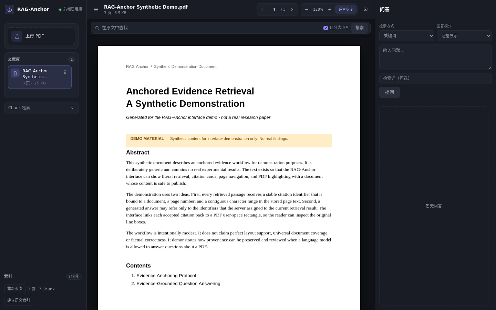
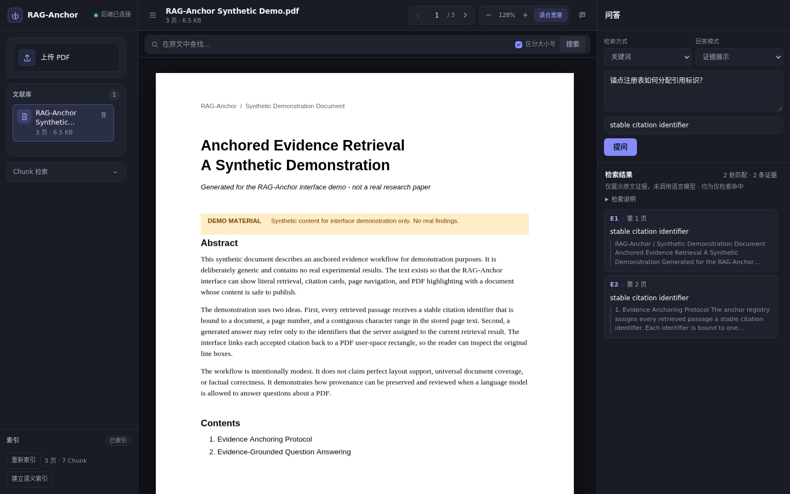
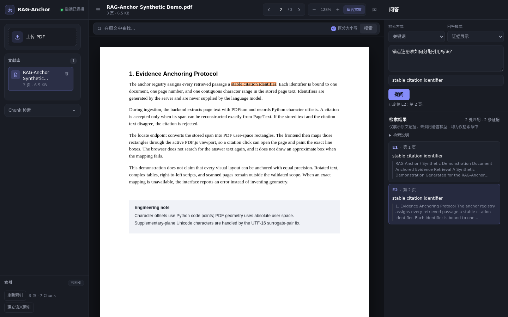

# RAG-Anchor

A traceable PDF research workspace for retrieval and question answering: every retrieval hit and model citation maps back to the real PDF text and is highlighted precisely in the viewer.

[简体中文](README.md) | **English**

## Two Core Capabilities

### Precise PDF Evidence Anchoring

- Retrieval hits and model citations are both tied to the real PDF text, rather than searching again for the answer text.
- Each citation carries an explicit page number and original character range; the server reconstructs the cited slice from stored page text.
- The backend uses PDFium (`pypdfium2`) for text extraction and coordinate mapping, returning per-line rectangles in absolute PDF user space.
- The frontend renders with PDF.js and maps rectangles through the active viewport; it does not perform manual pt-to-px conversion.
- Clicking a citation jumps to the corresponding page and highlights the original lines, within a page or across pages.
- Supplementary-plane Unicode characters (UTF-16 surrogate pairs) have a dedicated engineering fix.

Anchoring accuracy depends on the PDF text layer and layout. Rotated text, complex tables, RTL scripts, and scanned pages remain limited. The project does not claim 100% precise anchoring for arbitrary PDFs or layouts; when exact mapping is unavailable, the API returns an error instead of drawing an approximate box.

### Evidence-Grounded Cross-Lingual QA

- Ask in Chinese and retrieve English papers; supports literal retrieval and `bge-m3` semantic retrieval.
- Supports evidence-only answers (`evidence_only`, the default, with no language model) and optional Qwen generation (`grounded_generation`).
- In generation mode, the model may cite only the evidence identifiers allowed for the current retrieval result (`E1`, `E2`, ...); page numbers, offsets, chunk IDs, and PDF geometry are all reconstructed by the server.
- Citations must pass identifier whitelisting, original-text slice checks, and PDF location checks; invalid or unknown identifiers are rejected.
- Refusal is allowed when evidence is insufficient; the system never fabricates a successful answer from missing evidence.
- One fixed single-question real-model demo has verified the Top-12 evidence window, `qwen3:8b` generation, and E8/E12 citation navigation.

A locatable citation does not guarantee a correct conclusion. The server validates provenance and geometry, not factual entailment; answers can still be incomplete or overreach, and human review remains necessary.

## Screenshots

These screenshots come from a real running RAG-Anchor instance using a synthetic demo PDF clearly marked **DEMO MATERIAL**. They contain no real papers, user files, or private data.



**Document Research Workspace**: library and chunk retrieval on the left, the PDF.js reader in the center, and evidence QA on the right.



**Evidence-Grounded QA**: a Chinese question retrieves English evidence, and citation cards show identifiers, page numbers, and original snippets.



**Citation Navigation and PDF Highlighting**: clicking a citation opens the matching page and highlights the exact line rectangles in the PDF.

## Implemented Features

- **Document management**: PDF upload (picker or drag-and-drop), listing, detail lookup, deletion, and raw file access; on-disk filenames are derived only from UUIDs.
- **Text and indexes**: PDFium extracts page text; deterministic chunking persists page text, chunks, and Python character offsets; index builds and rebuilds atomically replace the previous index in one SQLite transaction.
- **Reading and navigation**: single-page PDF.js reading, paging, page jump, zoom, fit-to-width; in-document search, hit lists, previous/next hit, and automatic centered highlighting.
- **Literal retrieval**: searches indexed chunks and returns source offsets; no geometry is returned at this stage.
- **Semantic retrieval (optional)**: `bge-m3` embeddings, SQLite-derived vectors, and cosine Top-K; model name and digest are recorded, and stale indexes or changed models return a conflict error instead of falling back to literal retrieval.
- **Evidence-only QA**: single-document retrieval produces a verifiable citation list; no language model is called, and the mode runs fully offline.
- **AI-generated QA (optional)**: the same retrieved evidence is sent to an OpenAI-compatible service; the server assigns evidence identifiers and validates structured claims and citations; missing or unavailable models return explicit errors.
- **Citation location**: `evidence/locate` maps a retrieval span to PDFium character ranges and per-line geometry; the frontend uses the same path for navigation and highlighting.
- **Frontend interaction**: a Chinese three-column workspace, responsive drawers, toast error feedback, stale-request invalidation, and citation-highlight cleanup.

### Evidence Window in Generation Mode

The backend default is `max_citations=5`, and the `legacy` ranking remains unchanged. The current frontend explicitly sends `max_citations=12` for `grounded_generation`, while `evidence_only` keeps its existing request policy.

This is not a new ranking algorithm and not a proven global optimum. The wider evidence window reduces the chance that necessary evidence is truncated by Top-5; complex multi-evidence recall and model over-answering remain, and no formal benchmark data shows an accuracy improvement.

## Architecture

```text
PDF upload and reading
      ↓
PDFium text extraction + chunk index (page text, chunks, Python character offsets)
      ↓
Literal retrieval / optional bge-m3 semantic retrieval
      ↓
(Optional) Qwen generation: the server assigns evidence IDs; the model returns only structured claims and citation IDs
      ↓
Citation validation: identifiers, document ownership, text slices, and support spans are rebuilt by the server
      ↓
Precise PDF location: Python span → PDFium character range → per-line rectangles
      ↓
PDF.js viewport mapping and highlighting; explicit errors when location fails
```

| Layer | Stack |
| --- | --- |
| Backend | Python 3.11 + uv + FastAPI + Pydantic + SQLite + pytest + ruff |
| Frontend | TypeScript 5 + Vite 5 + plain HTML/CSS + `pdfjs-dist` 4 + Vitest 2 |
| Parsing | `pypdfium2` + PDFium; PyMuPDF is not installed before its license is confirmed |
| Retrieval | Literal chunk retrieval; optional `bge-m3` embeddings + SQLite-derived vectors + cosine Top-K |
| Models (optional) | Ollama (semantic) / OpenAI-compatible service (generation); disabled by default, no weights in the repository |
| Storage | Local filesystem + SQLite metadata |

The frontend does not use React, Vue, a UI component library, or a state-management library. The repository contains no model weights, inference framework, external vector database, OCR, PyTorch, or GPU code; semantic retrieval and generation call external model services over HTTP.

## Quick Start

### Basic Mode (No Ollama Required)

Basic mode covers PDF upload, text indexing, literal retrieval, evidence-only QA, and PDF reading, and runs fully offline.

**Backend requirements**: Python 3.11 managed by uv; the system must be able to load PDFium (installed with `pypdfium2`).

```bash
cd backend
export UV_LINK_MODE=copy

uv sync --locked
uv run python -V          # expect Python 3.11.x
uv run uvicorn rag_anchor.main:app --host 0.0.0.0 --port 8000
```

Health check:

```bash
curl http://127.0.0.1:8000/api/v1/health
# {"status":"ok","version":"0.1.0"}
```

Runtime data is written to `backend/.data/` by default (PDFs, temporary files, and `metadata.sqlite3`); override it with `RAG_ANCHOR_DATA_DIR`. The default upload limit is 20 MiB; override it with `RAG_ANCHOR_MAX_UPLOAD_BYTES`.

**Frontend requirements**: Node.js 18.20.8+ or 20+ (`package.json` declares `>=18.0.0`; Vite 5.4 requires `^18.0.0 || >=20.0.0`), npm 10+.

```bash
cd frontend
npm install
npm run dev
```

The dev server is configured to listen on `0.0.0.0:5173`; open `http://<host>:5173` in a browser. It proxies `/api` to `http://127.0.0.1:8000` by default, so the backend does not need CORS. To restrict access to the local machine, use `npm run dev -- --host 127.0.0.1`.

To change the proxy target:

```bash
cd frontend
cp .env.example .env.local
# edit .env.local
VITE_API_PROXY_TARGET=http://127.0.0.1:9000
```

`vite.config.ts` reads `.env`, `.env.local`, and `.env.<mode>[.local]` through `loadEnv()`; restart the dev server after changes.

### Enhanced Mode (Optional)

Semantic retrieval and AI-generated QA are available only after explicitly enabling and configuring model services:

- Semantic indexing/retrieval: Ollama `bge-m3` (`POST /api/embed` + `GET /api/tags`).
- Generated QA: an OpenAI-compatible `POST /chat/completions` endpoint; Ollama `qwen3:8b` can be used for local integration.

Configuring an address alone does not trigger any network request; the capability must also be explicitly enabled. The open-source repository contains code and documentation only, not Ollama model weights.

## Optional Model Configuration

### Generated QA

| Variable | Required | Default | Description |
| --- | --- | --- | --- |
| `RAG_ANCHOR_LLM_ENABLED` | Yes | `false` | Enables generation only for `1/true/yes/on` |
| `RAG_ANCHOR_LLM_BASE_URL` | Yes | empty | OpenAI-compatible base URL, must be `http(s)://...` |
| `RAG_ANCHOR_LLM_MODEL` | Yes | empty | Model name in the request body, not a local file path |
| `RAG_ANCHOR_LLM_API_KEY` | No | empty | Sent as `Authorization: Bearer ...` when set |
| `RAG_ANCHOR_LLM_TIMEOUT_SECONDS` | No | `60` | Per-request timeout in seconds |
| `RAG_ANCHOR_LLM_MAX_OUTPUT_TOKENS` | No | `512` | Output token limit per generation |
| `RAG_ANCHOR_LLM_REASONING_EFFORT` | No | empty | Optional `none/low/medium/high`; `none` is recommended for local Qwen3 use |

Example:

```bash
cd backend
export RAG_ANCHOR_LLM_ENABLED=true
export RAG_ANCHOR_LLM_BASE_URL=http://127.0.0.1:11434/v1
export RAG_ANCHOR_LLM_MODEL=<model-name>
# Thinking models such as Qwen3 can disable reasoning output:
# export RAG_ANCHOR_LLM_REASONING_EFFORT=none
uv run uvicorn rag_anchor.main:app --host 0.0.0.0 --port 8000
```

When generation is disabled, unconfigured, or unreachable, the API returns 503 / 502 / 504 respectively and never returns a fixed template disguised as a successful generation.

### Semantic Retrieval

| Variable | Default | Description |
| --- | --- | --- |
| `RAG_ANCHOR_EMBEDDING_ENABLED` | `false` | Enables semantic retrieval only for `1/true/yes/on` |
| `RAG_ANCHOR_EMBEDDING_BASE_URL` | empty | Ollama base URL, e.g. `http://127.0.0.1:11434` |
| `RAG_ANCHOR_EMBEDDING_MODEL` | empty | Embedding model name, e.g. `bge-m3`; do not use a chat model |
| `RAG_ANCHOR_EMBEDDING_MODEL_VERSION` | empty | Operations label, not proof of model identity |
| `RAG_ANCHOR_EMBEDDING_API_KEY` | empty | Optional; read only from the environment |
| `RAG_ANCHOR_EMBEDDING_TIMEOUT_SECONDS` | `120` | Per-embed-request timeout |
| `RAG_ANCHOR_EMBEDDING_BATCH_SIZE` | `16` | Texts per batch during indexing |
| `RAG_ANCHOR_EMBEDDING_MIN_SCORE` | `0.30` | Minimum cosine score for semantic candidates |

Before building or querying a semantic index, the service reads the model digest from `GET /api/tags` and stores `name + digest` as the stable identity; a digest mismatch returns 409 rather than treating uncertainty as "unchanged".

See [backend/README.md](backend/README.md) for full configuration and behavior.

## API Overview

| Method | Path | Description |
| --- | --- | --- |
| `GET` | `/api/v1/health` | Health check |
| `POST` | `/api/v1/documents` | Upload a PDF (multipart field `file`) |
| `GET` | `/api/v1/documents` | Paginated document list |
| `GET` | `/api/v1/documents/{document_id}` | Document details |
| `DELETE` | `/api/v1/documents/{document_id}` | Delete a document |
| `GET` | `/api/v1/documents/{document_id}/file` | Read the raw PDF bytes |
| `POST` | `/api/v1/documents/{document_id}/anchors/search` | Exact evidence-text search |
| `POST` | `/api/v1/documents/{document_id}/index` | Build or rebuild the chunk index |
| `POST` | `/api/v1/documents/{document_id}/semantic-index` | Build or rebuild the derived semantic index (optional) |
| `POST` | `/api/v1/retrieval/search` | Search indexed chunks and return source offsets |
| `POST` | `/api/v1/documents/{document_id}/evidence/locate` | Map a retrieval span to real PDF geometry |
| `POST` | `/api/v1/documents/{document_id}/qa` | Evidence-only (default) or AI-generated QA with server-validated citations |

`rects` are per-line rectangles in absolute PDF user space (points), and `bbox` is a derived outer box; see [ADR-0001](docs/adr/0001-coordinate-contract.md). Full request and response examples are in [backend/README.md](backend/README.md).

## Verification and Evaluation

Frontend (actual current result: 11 test files, 139 tests passing):

```bash
cd frontend
npm run typecheck
npm test
npm run build
```

Backend:

```bash
cd backend
export UV_LINK_MODE=copy
uv run pytest
uv run ruff check .
uv run ruff format --check .
uv lock --check
```

Automated tests use injected Fake/Mock providers and make no real model requests. The M2 fixed synthetic-set regression, B1/B2 experiments, first real-PDF exploration results, and known limitations are documented in the [M2 quality evaluation report](docs/m2-quality-evaluation.md). These numbers come from specific models, specific datasets, and single runs; they are not a formal benchmark and must not be treated as production accuracy.

## Known Limitations

- Local development MVP: no authentication, rate limiting, or auditing.
- No OCR: scanned or image-only PDFs have no searchable text.
- Single-page rendering (current page only), without continuous scrolling or virtualization.
- PDFs are fully loaded into memory through `fetch` (upload limit 20 MiB); HTTP Range is not used.
- Encrypted PDFs, precise quads for arbitrarily rotated text, RTL scripts, and complex table reading order are unsupported.
- Anchor search reopens the PDF each time and caches no coordinates; chunk retrieval reads only an existing index.
- SQLite uses short-lived connections, suitable for single-machine development but not for multi-worker high-concurrency writes.
- Semantic retrieval is single-document only and uses brute-force cosine Top-K over SQLite-derived vectors; `0.30` is a current setting, not a verified optimum.
- Complex multi-evidence recall remains incomplete; evidence that reaches Top-5 can still be omitted by the generation model, and the model can over-answer.
- The server validates citation identifiers, text slices, and PDF location, but not factual entailment between claims and evidence; a locatable citation does not guarantee a correct conclusion.
- Chinese patent-specific validation is not complete; the first real-PDF exploration questions and the remaining real-question labels are still drafts, not a formal benchmark.
- Real-browser acceptance has covered PDF reading and document switching, literal chunk retrieval, semantic indexing, Chinese questions over English evidence, citation navigation and highlighting, refusal behavior, and stale QA highlight cleanup; rapid consecutive requests, model failures, semantic-index anomalies/expiry, and the full boundary matrix have not all been manually accepted.
- No agents, reranker, patent-specific retrieval, factual-entailment validation, OCR, or cross-document retrieval.

## Documentation

- [Architecture](docs/architecture.md)
- [M2 quality evaluation report](docs/m2-quality-evaluation.md)
- [ADR-0001: Coordinate contract](docs/adr/0001-coordinate-contract.md)
- [M0-06C anchor benchmark reproducibility audit](docs/benchmark-audit.md)
- [Manual browser acceptance checklist](docs/manual-ui-acceptance.md)
- [Frontend guide](frontend/README.en.md)
- [Backend guide](backend/README.md)
- [中文 README](README.md)

## License

The MIT license is being prepared; the repository does not yet contain a `LICENSE` file, and the formal copyright attribution is pending. Until the license file is in place, the project is not represented as MIT-licensed.
