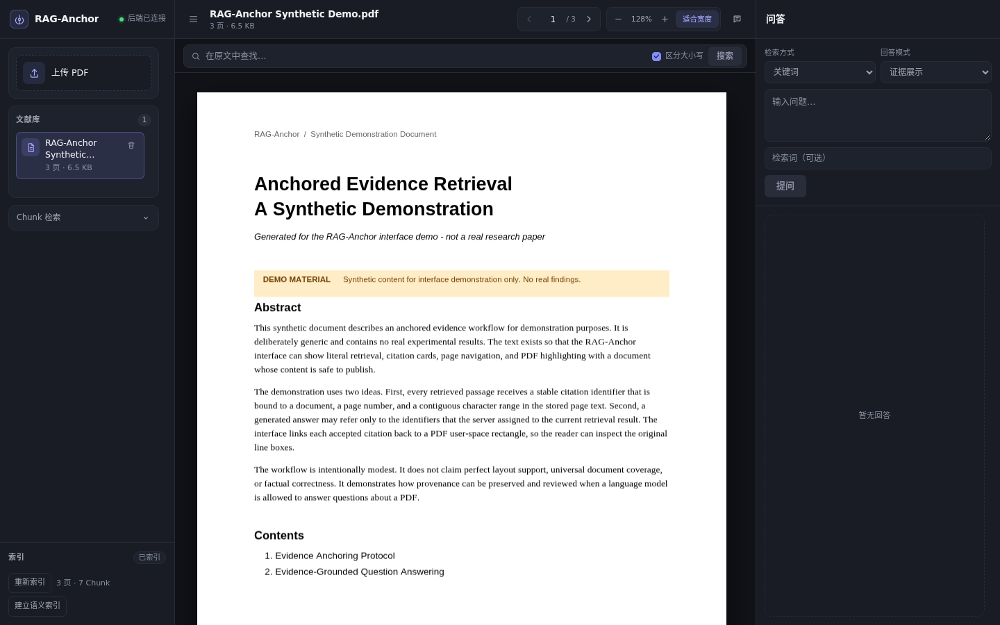
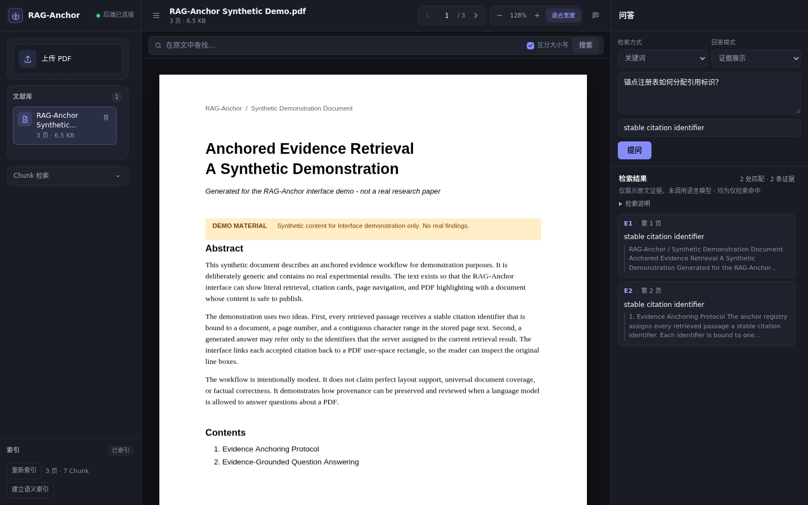
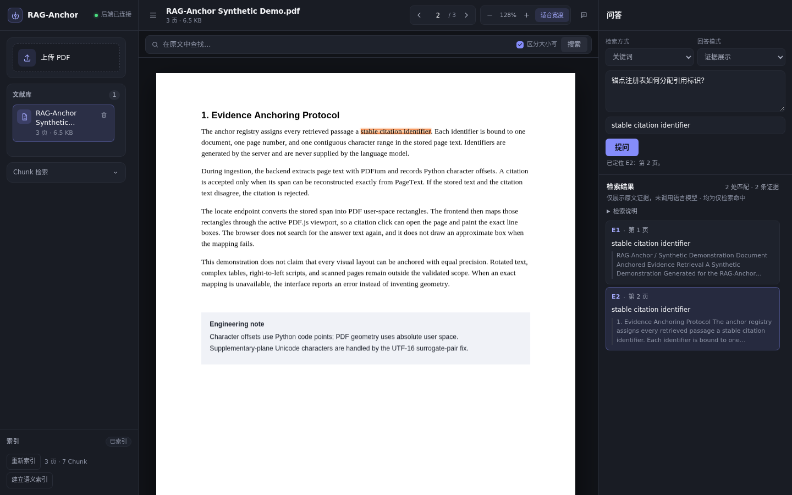

# RAG-Anchor

可追溯的 PDF 文献检索与问答工作台：检索命中与模型引用都能回到真实 PDF 原文，并在阅读器中精确高亮。

**简体中文** | [English](README.en.md)

## 两个核心能力

### 原文级精准引用定位 · Precise PDF Evidence Anchoring

- 检索命中与模型引用都关联真实 PDF 原文，而不是根据答案文本再次搜索。
- 每条引用包含明确页码与原文字符范围，服务端从存储的页面文本重建引用切片。
- 后端使用 PDFium（`pypdfium2`）完成文本抽取与坐标映射，返回 absolute PDF user space 的逐行矩形。
- 前端使用 PDF.js 渲染，并通过当前 viewport 把矩形映射到屏幕坐标；不做手工 pt→px 换算。
- 点击引用可跳转到对应页面并高亮原始行，同页与跨页均支持。
- 补充平面 Unicode 字符（UTF-16 代理对）的定位问题已有工程修复。

定位精度取决于 PDF 的文本层与版式。旋转文字、复杂表格、RTL 与扫描件仍有限制，不宣称任意 PDF、任意版式都能 100% 精确定位；无法精确映射时接口返回错误，不绘制近似框。

### 证据约束的跨语言问答 · Evidence-Grounded Cross-Lingual QA

- 中文提问，可检索英文论文；支持字面检索与 `bge-m3` 语义检索。
- 支持仅证据展示（`evidence_only`，默认，不调用语言模型）与可选 Qwen 生成（`grounded_generation`）。
- 生成模式下，模型只能引用本次检索允许的证据编号（`E1`、`E2`…）；页码、偏移、Chunk ID 与 PDF 几何全部由服务端重建。
- 引用需要通过编号白名单、原文切片与 PDF 定位校验；非法或未知编号会被拒绝。
- 证据不足时允许拒答；无证据不会伪造成功。
- 已在一次固定单题真实演示中完成 Top-12 证据窗口、`qwen3:8b` 生成与 E8/E12 引用跳转验证。

引用可定位不等于结论一定正确。服务端校验的是引用来源与几何，不验证事实蕴含；回答仍可能不完整或过度回答，需要人工核对原文。

## 界面

截图来自真实运行的 RAG-Anchor，使用明确标注 **DEMO MATERIAL** 的合成演示 PDF，不包含真实论文、用户文件或隐私数据。



**中文文献工作台**：左侧文献库与 Chunk 检索，中间 PDF.js 阅读器，右侧证据问答。



**可追溯问答**：中文问题检索英文证据，引用卡片显示编号、页码与原文片段。



**引用跳转与原文高亮**：点击引用后跳转到对应页面，并高亮 PDF 原文的精确行矩形。

## 已实现功能

- **文档管理**：PDF 上传（选择/拖放）、列表、详情、删除与原始文件读取；磁盘文件名只由 UUID 派生。
- **文本与索引**：PDFium 抽取页面文本，确定性切分 Chunk，持久化页面文本、Chunk 与 Python 字符偏移；建立/重建索引在单个 SQLite 事务内原子替换。
- **阅读与定位**：PDF.js 单页阅读、翻页、页码跳转、缩放、适合宽度；原文搜索、命中列表、上一/下一命中与自动居中高亮。
- **字面检索**：在已索引 Chunk 中检索，返回来源偏移；不返回几何坐标。
- **语义检索（可选）**：`bge-m3` embedding + SQLite 派生向量 + 余弦 Top-K；记录模型名与 digest，模型变化或索引过期时返回冲突错误，不回退到字面检索。
- **证据展示问答**：单文档检索 → 可验证引用列表；不调用语言模型，可完全离线运行。
- **AI 生成问答（可选）**：同一份检索证据 → OpenAI 兼容服务 → 服务端分配证据编号 → 结构化 claims 与引用校验；模型未配置或不可用时返回明确错误。
- **引用定位**：`evidence/locate` 把检索 span 映射为 PDFium 字符区间与逐行几何矩形；前端复用同一路径完成跳转与高亮。
- **前端交互**：中文三栏工作台、响应式抽屉、Toast 错误反馈、旧请求失效保护与引用高亮清理。

### 生成模式的证据窗口

后端默认 `max_citations=5`，`legacy` 排序保持不变。当前前端在 `grounded_generation` 模式下显式发送 `max_citations=12`，`evidence_only` 保持原有请求策略。

这不是新的排序算法，也不是已证明全局最优的参数。更大的证据窗口用于减少必要证据被 Top-5 截断的问题；复杂多证据召回与模型过度回答等限制仍然存在，也没有相应的正式基准数据证明准确率提升。

## 技术架构

```text
PDF 上传与阅读
      ↓
PDFium 文本抽取 + Chunk 索引（页面文本、Chunk、Python 字符偏移）
      ↓
字面检索 / 可选 bge-m3 语义检索
      ↓
（可选）Qwen 生成：服务端分配证据编号，模型只返回结构化 claims 与引用编号
      ↓
引用校验：编号、文档归属、原文切片与支持区间由服务端重建
      ↓
PDF 精确定位：Python span → PDFium 字符区间 → 逐行矩形
      ↓
PDF.js viewport 映射与高亮；定位失败时显式报错
```

| 层 | 选型 |
| --- | --- |
| 后端 | Python 3.11 + uv + FastAPI + Pydantic + SQLite + pytest + ruff |
| 前端 | TypeScript 5 + Vite 5 + 原生 HTML/CSS + `pdfjs-dist` 4 + Vitest 2 |
| 解析 | `pypdfium2` + PDFium；PyMuPDF 在许可证确认前不安装 |
| 检索 | 字面 Chunk 检索；可选 `bge-m3` embedding + SQLite 派生向量 + 余弦 Top-K |
| 模型（可选） | Ollama（语义）/ OpenAI 兼容服务（生成）；默认关闭，仓库不含权重 |
| 存储 | 本地文件系统 + SQLite 元数据 |

前端不使用 React / Vue、UI 组件库或状态管理库。仓库不包含模型权重、推理框架、外部向量数据库、OCR、PyTorch 或 GPU 代码；语义检索与生成模式均通过 HTTP 调用外部模型服务。

## 快速开始

### 基础模式（不依赖 Ollama）

基础模式可以完成 PDF 上传、文本索引、字面检索、证据展示与 PDF 阅读，完全离线运行。

**后端要求**：Python 3.11（由 uv 管理），系统需能加载 PDFium（`pypdfium2` 随依赖安装）。

```bash
cd backend
export UV_LINK_MODE=copy

uv sync --locked
uv run python -V          # 期望 Python 3.11.x
uv run uvicorn rag_anchor.main:app --host 0.0.0.0 --port 8000
```

健康检查：

```bash
curl http://127.0.0.1:8000/api/v1/health
# {"status":"ok","version":"0.1.0"}
```

运行时数据默认写入 `backend/.data/`（PDF、临时文件与 `metadata.sqlite3`），可用 `RAG_ANCHOR_DATA_DIR` 覆盖。上传大小默认上限 20 MiB，可用 `RAG_ANCHOR_MAX_UPLOAD_BYTES` 调整。

**前端要求**：Node.js 18.20.8+ 或 20+（`package.json` 声明 `>=18.0.0`；Vite 5.4 要求 `^18.0.0 || >=20.0.0`），npm 10+。

```bash
cd frontend
npm install
npm run dev
```

开发服务器配置为监听 `0.0.0.0:5173`，浏览器访问 `http://<host>:5173`。默认把 `/api` 代理到 `http://127.0.0.1:8000`，因此后端不需要开启 CORS。如需限制为本机访问，可使用 `npm run dev -- --host 127.0.0.1`。

修改代理目标：

```bash
cd frontend
cp .env.example .env.local
# 编辑 .env.local
VITE_API_PROXY_TARGET=http://127.0.0.1:9000
```

`vite.config.ts` 通过 `loadEnv()` 读取 `.env`、`.env.local` 与 `.env.<mode>[.local]`；修改后需重启开发服务器。

### 增强模式（可选）

显式启用并配置模型服务后，才可使用语义检索与 AI 生成问答：

- 语义索引/检索：Ollama `bge-m3`（`POST /api/embed` + `GET /api/tags`）。
- 生成问答：OpenAI 兼容 `POST /chat/completions`，本机联调可使用 Ollama `qwen3:8b`。

只配置地址不会触发网络请求；必须同时显式启用。开源仓库只包含代码与文档，不包含 Ollama 模型权重。

## 可选模型配置

### 生成式问答

| 环境变量 | 必填 | 默认值 | 说明 |
| --- | --- | --- | --- |
| `RAG_ANCHOR_LLM_ENABLED` | 是 | `false` | `1/true/yes/on` 才启用生成模式 |
| `RAG_ANCHOR_LLM_BASE_URL` | 是 | 空 | OpenAI 兼容服务根地址，必须为 `http(s)://...` |
| `RAG_ANCHOR_LLM_MODEL` | 是 | 空 | 请求体中的模型名称，不是本地文件路径 |
| `RAG_ANCHOR_LLM_API_KEY` | 否 | 空 | 设置后以 `Authorization: Bearer ...` 发送 |
| `RAG_ANCHOR_LLM_TIMEOUT_SECONDS` | 否 | `60` | 单次请求超时（秒） |
| `RAG_ANCHOR_LLM_MAX_OUTPUT_TOKENS` | 否 | `512` | 单次生成输出 token 上限 |
| `RAG_ANCHOR_LLM_REASONING_EFFORT` | 否 | 空 | 可选 `none/low/medium/high`；Qwen3 本地联调建议 `none` |

示例：

```bash
cd backend
export RAG_ANCHOR_LLM_ENABLED=true
export RAG_ANCHOR_LLM_BASE_URL=http://127.0.0.1:11434/v1
export RAG_ANCHOR_LLM_MODEL=<模型名称>
# Qwen3 等 thinking 模型可关闭推理输出：
# export RAG_ANCHOR_LLM_REASONING_EFFORT=none
uv run uvicorn rag_anchor.main:app --host 0.0.0.0 --port 8000
```

未启用、未配置或连接失败时分别返回 503 / 502 / 504，不会返回固定模板伪装成生成成功。

### 语义检索

| 环境变量 | 默认值 | 说明 |
| --- | --- | --- |
| `RAG_ANCHOR_EMBEDDING_ENABLED` | `false` | `1/true/yes/on` 才启用 |
| `RAG_ANCHOR_EMBEDDING_BASE_URL` | 空 | Ollama 根地址，例如 `http://127.0.0.1:11434` |
| `RAG_ANCHOR_EMBEDDING_MODEL` | 空 | embedding 模型名，例如 `bge-m3`；不得使用聊天模型 |
| `RAG_ANCHOR_EMBEDDING_MODEL_VERSION` | 空 | 运维修订标签，不是模型身份证明 |
| `RAG_ANCHOR_EMBEDDING_API_KEY` | 空 | 可选；只从环境变量读取 |
| `RAG_ANCHOR_EMBEDDING_TIMEOUT_SECONDS` | `120` | 单次 embed 请求超时 |
| `RAG_ANCHOR_EMBEDDING_BATCH_SIZE` | `16` | 建索引时每批文本数 |
| `RAG_ANCHOR_EMBEDDING_MIN_SCORE` | `0.30` | 语义候选的最低余弦相似度 |

建立或查询语义索引前，服务会通过 `GET /api/tags` 读取模型 digest，并与模型名组成稳定身份写入派生索引；digest 不一致时返回 409，不把不确定性当作“未变化”。

完整配置与行为见 [backend/README.md](backend/README.md)。

## API 概览

| 方法 | 路径 | 说明 |
| --- | --- | --- |
| `GET` | `/api/v1/health` | 健康检查 |
| `POST` | `/api/v1/documents` | 上传 PDF（multipart 字段名 `file`） |
| `GET` | `/api/v1/documents` | 分页列出文档 |
| `GET` | `/api/v1/documents/{document_id}` | 文档详情 |
| `DELETE` | `/api/v1/documents/{document_id}` | 删除文档 |
| `GET` | `/api/v1/documents/{document_id}/file` | 读取 PDF 原始字节 |
| `POST` | `/api/v1/documents/{document_id}/anchors/search` | 精确检索证据文字 |
| `POST` | `/api/v1/documents/{document_id}/index` | 建立或重建 Chunk 索引 |
| `POST` | `/api/v1/documents/{document_id}/semantic-index` | 建立或重建派生语义向量索引（可选） |
| `POST` | `/api/v1/retrieval/search` | 在已索引 Chunk 中检索并返回来源偏移 |
| `POST` | `/api/v1/documents/{document_id}/evidence/locate` | 将检索 span 定位为真实 PDF 几何 |
| `POST` | `/api/v1/documents/{document_id}/qa` | 证据展示（默认）或 AI 生成问答，引用由服务端校验 |

`rects` 为 absolute PDF user space（points）的逐行矩形，`bbox` 是派生外包框；坐标契约见 [ADR-0001](docs/adr/0001-coordinate-contract.md)。完整请求/响应示例见 [backend/README.md](backend/README.md)。

## 验证与评测

前端（当前实际验证：11 个测试文件、139 项测试通过）：

```bash
cd frontend
npm run typecheck
npm test
npm run build
```

后端：

```bash
cd backend
export UV_LINK_MODE=copy
uv run pytest
uv run ruff check .
uv run ruff format --check .
uv lock --check
```

自动化测试使用注入的 Fake/Mock Provider，不发起真实模型请求。M2 的固定合成集回归、B1/B2 实验、首轮真实 PDF 探索结果与已知限制见 [M2 质量评测报告](docs/m2-quality-evaluation.md)。这些数字来自特定模型、特定数据集与单次运行，不是正式 benchmark，也不能当作生产准确率。

## 已知限制

- 本地开发 MVP：无认证、无速率限制、无审计。
- 不做 OCR：扫描件、图片型 PDF 无可检索文本。
- 单页渲染（只渲染当前页），不做连续滚动或虚拟化。
- PDF 通过 `fetch` 全量加载到内存（上传上限 20 MiB），不依赖 HTTP Range。
- 不支持加密 PDF、任意角度旋转文字的精确四边形、RTL、复杂表格阅读顺序。
- 锚点搜索每次重新打开 PDF，无坐标缓存；Chunk 检索只读取已建立索引的数据。
- SQLite 短连接，适合单机开发，不适合多 worker 高并发写入。
- 语义检索只支持单文档，使用 SQLite 派生向量上的暴力余弦 Top-K；`0.30` 是当前配置，不是已验证的最优阈值。
- 复杂多证据召回仍不完整；已进入 Top-5 的证据仍可能被生成模型遗漏；模型也可能过度回答。
- 服务端只校验引用编号、原文切片与 PDF 定位，不验证 claim 与证据之间的事实支持；引用可定位不等于结论正确。
- 中文专利专项验证尚未完成；首轮真实 PDF 探索题与其余真实问题标签仍为 Draft，不是正式 benchmark。
- 真实浏览器已验收 PDF 阅读与文档切换、Chunk 字面检索、语义索引、中文问题查询英文证据、引用跳转与高亮、拒答行为及旧 QA 高亮清理；快速连续请求、模型故障、语义索引异常/过期与完整边界场景尚未全部人工验收。
- 不包含 Agent、reranker、专利专项检索、事实蕴含验证、OCR 或跨文档检索。

## 文档

- [架构说明](docs/architecture.md)
- [M2 质量评测报告](docs/m2-quality-evaluation.md)
- [ADR-0001：坐标契约](docs/adr/0001-coordinate-contract.md)
- [M0-06C 锚点评测可复现性审查](docs/benchmark-audit.md)
- [人工浏览器验收清单](docs/manual-ui-acceptance.md)
- [前端说明](frontend/README.md)
- [后端说明](backend/README.md)
- [English README](README.en.md)

## License

MIT 许可证准备中；当前仓库尚未包含 `LICENSE` 文件，正式版权署名待确认。在许可证文件正式落地前，不将本项目表述为已采用 MIT 许可。
