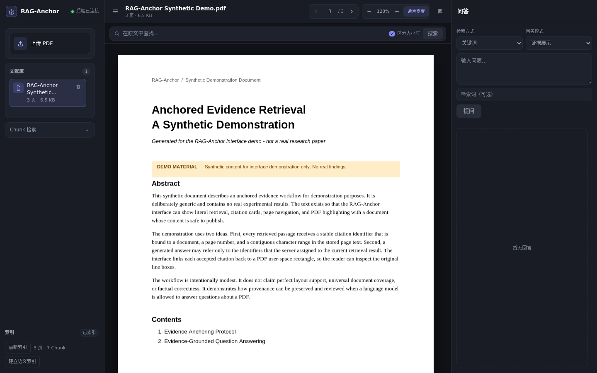

# RAG-Anchor Frontend

A traceable PDF research workspace for retrieval and question answering. The current M2 implementation covers three main flows: PDF reading and in-document search, literal/semantic chunk retrieval, and evidence-only or optional AI-generated QA; every citation can return to the original PDF text and be highlighted precisely.

[简体中文](README.md) | **English**

Stack: Vite 5 + TypeScript 5 + plain HTML/CSS + `pdfjs-dist` 4 + Vitest 2. No React, Vue, UI component library, or state-management library.



## Requirements

- Node.js 18.20.8+ or 20+. `package.json` declares `engines.node: >=18.0.0`; Vite 5.4.21 requires `^18.0.0 || >=20.0.0`.
- npm 10+.
- Backend running at `http://127.0.0.1:8000`.
- PDFs must contain an extractable text layer; scanned and image-only PDFs are not supported because there is no OCR.

## Installation

```bash
cd frontend
npm install
```

## Development

```bash
npm run dev
```

The dev server is configured to listen on `0.0.0.0:5173` (`server.host` in `vite.config.ts`); open `http://<host>:5173` in a browser. To allow local access only:

```bash
npm run dev -- --host 127.0.0.1
```

The dev server proxies `/api` to `http://127.0.0.1:8000`, so the backend does not need CORS.

## Scripts

| Command             | Description                                   |
| ------------------- | --------------------------------------------- |
| `npm run dev`       | Start the Vite dev server                     |
| `npm run typecheck` | `tsc --noEmit` (app and Vite config)          |
| `npm test`          | Vitest unit tests (`tests/**/*.test.ts`)      |
| `npm run build`     | Type-check + production build into `dist/`    |
| `npm run preview`   | Preview the production build (`0.0.0.0:5173`) |

## Proxy Configuration

The default proxy target is `http://127.0.0.1:8000`. To change it:

```bash
cp .env.example .env.local
# edit .env.local
VITE_API_PROXY_TARGET=http://127.0.0.1:9000
```

`vite.config.ts` reads `.env`, `.env.local`, and `.env.<mode>[.local]` through `loadEnv()`; restart the dev server after changes. `.env.example` declares no frontend variable other than `VITE_API_PROXY_TARGET`.

## Project Structure

```text
frontend/
├── index.html               # Static layout and all DOM anchors
├── package.json
├── package-lock.json
├── tsconfig.json
├── tsconfig.node.json
├── vite.config.ts
├── .env.example
├── src/
│   ├── main.ts              # UI controller: documents, reading, retrieval, QA, citation location
│   ├── styles.css           # Design tokens, three-column layout, states, responsive drawers
│   ├── api/
│   │   ├── types.ts         # TypeScript mirrors of FastAPI response models
│   │   └── client.ts        # HTTP requests, FormData, error mapping
│   ├── pdf/
│   │   └── viewer.ts        # PDF.js loading, rendering, paging, zoom, disposal
│   ├── highlight/
│   │   ├── ownership.ts     # Highlight state by source (in-document search / QA citations)
│   │   ├── renderer.ts      # Viewport conversion and highlight overlay
│   │   └── selection.ts     # Current-page highlight selection and active markers
│   ├── qa/
│   │   ├── citation.ts      # Citation labels, support spans, document ownership checks
│   │   ├── mode.ts          # Mode labels, error messages, Top-12 request policy
│   │   ├── refusal.ts       # Insufficient-evidence refusal messages
│   │   └── request.ts       # Stale QA response detection
│   ├── retrieval/
│   │   └── chunk.ts         # Chunk result pagination and evidence spans
│   └── ui/
│       ├── request.ts       # Generic request gate
│       └── scroll.ts        # Hit-centering scroll and render timing coordination
└── tests/                   # 11 Vitest test files
```

## PDF Rendering

`GET /api/v1/documents/{document_id}/file` → `ArrayBuffer` → PDF.js `getDocument({ data })`.

- The worker is imported through Vite `?url` from `pdfjs-dist/build/pdf.worker.min.mjs`, matching the `pdfjs-dist` version.
- Single-page rendering: only the current page is rendered; there is no continuous scrolling or virtualization.
- Supports paging, page jump, zoom in, zoom out, and fit-to-width.
- Every document selection loads the full PDF into memory; the backend upload limit is 20 MiB, and HTTP Range is not used.
- Paging, zoom, and timing changes are coordinated through render tokens; `RenderingCancelledException` is ignored silently, and a stale render never overwrites the latest page.

## Evidence Highlighting

The backend returns `rects` in **absolute PDF user space** (points), following [ADR-0001](../docs/adr/0001-coordinate-contract.md). The frontend performs exactly one mapping:

```text
PDF user space → page.getViewport({ scale, rotation })
→ viewport.convertToViewportRectangle()
→ min/max normalization → absolutely positioned overlay div
```

- No CropBox translation, no repeated page rotation, and no treating points as CSS pixels.
- Multi-line evidence is drawn line by line from the backend `rects`; lines are not merged into one cross-line box.
- In-document search hits and QA citations use different highlight sources and can be cleared independently; switching documents or searching again clears old highlights.
- After a hit or citation is clicked, `activateHit()` / `locateQaCitation()` switches to the target page, waits for rendering and highlighting, then centers the active highlight in the `#viewer-stage` viewport.
- Zooming or resizing triggers a PDF.js re-render, and the highlight layer re-maps all `rects` through the new viewport.
- If citation location fails, the UI shows an error and never falls back to text search or an approximate box.

## QA Modes

QA combines two orthogonal dimensions:

| Dimension | Values | Notes |
| --- | --- | --- |
| Retrieval mode | `literal` (default) / `semantic` | Semantic retrieval requires an existing semantic index; failures do not fall back to literal retrieval |
| Answer mode | `evidence_only` (default) / `grounded_generation` | Generation requires an explicitly configured model service on the backend |

- **Evidence only (`evidence_only`)**: returns retrieved evidence and citation cards without calling a language model; explicitly refuses when no evidence is found.
- **AI generation (`grounded_generation`)**: calls the model with the same retrieved evidence; the model may cite only server-assigned identifiers such as `E1`, `E2`, ...; malformed output or unknown identifiers are rejected.
- **Citation cards**: show identifier, page number, support kind (literal match / semantic candidate), matched text, and chunk context; semantic citations also show a similarity score.
- **Citation click**: after verifying that the citation belongs to the current document, calls `evidence/locate` to navigate and highlight the original text; location failures surface an error.
- **Top-12 request policy**: `grounded_generation` explicitly sends `max_citations=12`, while `evidence_only` keeps the client's existing default behavior. The backend default remains 5 and `legacy` ranking is unchanged; this is neither a new ranking algorithm nor a proven optimum.
- **Response checks**: if the returned `answer_mode` / `retrieval_mode` does not match the request, the frontend treats it as an error and does not display the answer.

## State and Race Conditions

- Switching documents, paging, and zooming increment render tokens; stale async results never overwrite the latest state.
- Chunk retrieval, QA, citation location, and semantic indexing each use an independent request gate.
- QA responses validate the request token, current document, answer mode, and retrieval mode together; old responses are dropped after a document or mode change.
- Rapid consecutive hit clicks discard older scroll requests; the results list only scrolls the minimum necessary distance.
- Switching documents clears old highlights and old QA output; deleting the current document closes the reader before refreshing the list.
- Errors are surfaced through inline hints and toasts; unconfigured generation, unavailable models, and semantic-index anomalies all produce explicit errors.

## Testing

```bash
npm run typecheck
npm test
npm run build
```

Actual current result: **11 test files, 139 tests passing**. Coverage includes:

- API client: document listing, upload field `file`, chunk retrieval, QA request body, zero hits, error `detail`, network errors, file bytes, 204 deletion, and `max_citations` serialization.
- Highlighting: ordinary rectangles, axis reversal, zoom scale, non-default CropBox origin, multi-line rectangle preservation, zero-area filtering, active markers, and highlight-source ownership.
- Hit centering: same-page/cross-page targeting, up and down directions, rapid-click races, boundary clamping, multi-line hit unions, and minimal results-list scrolling.
- QA: mode labels, Top-12 policy, refusal messages, stale-request detection, citation labels, and support spans.

`paintHighlights()` depends on the DOM, and Vitest runs with `environment: "node"`, so unit tests cover only the pure functions; real-browser acceptance is performed separately.

## Known Limitations

- Local development MVP: no authentication, rate limiting, or OCR.
- Single-page rendering (current page only), without continuous scrolling or virtualization.
- PDFs are fully loaded into memory (upload limit 20 MiB).
- Scanned PDFs, encrypted PDFs, precise quads for arbitrarily rotated text, RTL scripts, and complex table reading order are unsupported.
- Single-document retrieval and QA only; no cross-document retrieval, multi-turn chat, reranking, or query rewriting.
- Semantic QA depends on the backend embedding service; unavailable models or stale indexes produce explicit errors.
- Top-12 only widens the evidence window for generation mode; it does not guarantee that necessary evidence is retrieved or used, nor that the answer is correct.
- A locatable citation does not guarantee factual correctness; answers still require human review against the original text.
- The UI and messages are currently in Chinese.
- Real-browser acceptance has covered PDF reading and document switching, literal chunk retrieval, semantic indexing, Chinese questions over English evidence, citation navigation and highlighting, refusal behavior, and stale QA highlight cleanup; rapid consecutive requests, model failures, semantic-index anomalies/expiry, and the full boundary matrix have not all been manually accepted.
