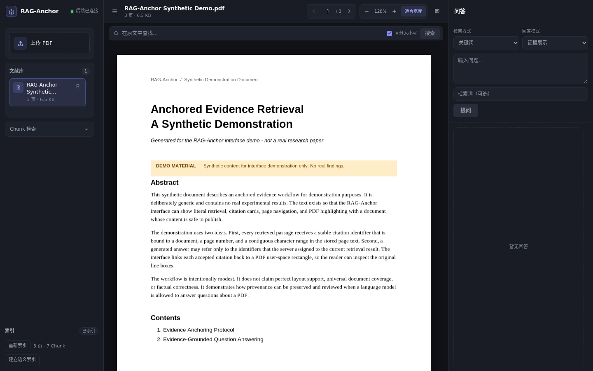

# RAG-Anchor 前端

可追溯的 PDF 文献检索与问答工作台。当前 M2 实现覆盖三条主链路：PDF 阅读与原文检索、Chunk 字面/语义检索、证据展示与可选 AI 生成问答；所有引用都可以回到 PDF 原文并精确高亮。

**简体中文** | [English](README.en.md)

技术栈：Vite 5 + TypeScript 5 + 原生 HTML/CSS + `pdfjs-dist` 4 + Vitest 2。不使用 React / Vue / UI 组件库 / 状态管理库。



## 环境要求

- Node.js 18.20.8+ 或 20+。`package.json` 声明 `engines.node: >=18.0.0`；Vite 5.4.21 要求 `^18.0.0 || >=20.0.0`。
- npm 10+。
- 后端运行在 `http://127.0.0.1:8000`。
- PDF 需要包含可抽取的文本层；扫描件与图片型 PDF 不支持 OCR。

## 安装

```bash
cd frontend
npm install
```

## 开发

```bash
npm run dev
```

开发服务器配置为监听 `0.0.0.0:5173`（`vite.config.ts` 中的 `server.host`），浏览器访问 `http://<host>:5173`。如需只允许本机访问：

```bash
npm run dev -- --host 127.0.0.1
```

开发服务器把 `/api` 代理到 `http://127.0.0.1:8000`，因此后端不需要开启 CORS。

## 脚本

| 命令                | 说明                                      |
| ------------------- | ----------------------------------------- |
| `npm run dev`       | 启动 Vite 开发服务器                      |
| `npm run typecheck` | `tsc --noEmit`（应用与 Vite 配置）        |
| `npm test`          | Vitest 单测（`tests/**/*.test.ts`）       |
| `npm run build`     | 类型检查 + 生产构建到 `dist/`             |
| `npm run preview`   | 预览生产构建（默认 `0.0.0.0:5173`）       |

## 代理配置

默认代理目标为 `http://127.0.0.1:8000`。如需修改：

```bash
cp .env.example .env.local
# 编辑 .env.local
VITE_API_PROXY_TARGET=http://127.0.0.1:9000
```

`vite.config.ts` 使用 `loadEnv()` 读取 `.env`、`.env.local` 与 `.env.<mode>[.local]`；修改后需重启开发服务器。除 `VITE_API_PROXY_TARGET` 外，`.env.example` 没有声明其他前端变量。

## 目录结构

```text
frontend/
├── index.html               # 静态布局与全部 DOM 锚点
├── package.json
├── package-lock.json
├── tsconfig.json
├── tsconfig.node.json
├── vite.config.ts
├── .env.example
├── src/
│   ├── main.ts              # UI 控制器：文档/阅读/检索/问答/引用定位
│   ├── styles.css           # 设计令牌、三栏布局、状态样式、响应式抽屉
│   ├── api/
│   │   ├── types.ts         # FastAPI 响应模型的 TypeScript 镜像
│   │   └── client.ts        # HTTP 请求、FormData、错误映射
│   ├── pdf/
│   │   └── viewer.ts        # PDF.js 加载、渲染、翻页、缩放、销毁
│   ├── highlight/
│   │   ├── ownership.ts     # 按来源（原文检索/问答引用）维护高亮状态
│   │   ├── renderer.ts      # viewport 坐标转换与高亮 overlay
│   │   └── selection.ts     # 当前页高亮选择与 active 标记
│   ├── qa/
│   │   ├── citation.ts      # 引用标签、支持区间与文档归属校验
│   │   ├── mode.ts          # 模式标签、错误提示、Top-12 请求策略
│   │   ├── refusal.ts       # 证据不足拒答提示
│   │   └── request.ts       # 旧问答响应失效判断
│   ├── retrieval/
│   │   └── chunk.ts         # Chunk 结果分页与证据 span
│   └── ui/
│       ├── request.ts       # 通用请求闸门
│       └── scroll.ts        # 命中居中滚动与渲染时序协调
└── tests/                   # 11 个 Vitest 测试文件
```

## PDF 渲染

`GET /api/v1/documents/{document_id}/file` → `ArrayBuffer` → PDF.js `getDocument({ data })`。

- Worker 通过 Vite `?url` 导入 `pdfjs-dist/build/pdf.worker.min.mjs`，与 `pdfjs-dist` 版本一致。
- 单页渲染：只渲染当前页，不做连续滚动或虚拟化。
- 支持翻页、页码跳转、放大、缩小与适合宽度。
- 每次选择文档都会完整加载 PDF 到内存；后端上传上限为 20 MiB，不使用 HTTP Range。
- 翻页、缩放与时序变化通过渲染 token 协调；`RenderingCancelledException` 静默忽略，过期渲染不会覆盖最新页面。

## 证据高亮

后端返回的 `rects` 是 **absolute PDF user space**（points），遵循 [ADR-0001](../docs/adr/0001-coordinate-contract.md)。前端只做一次映射：

```text
PDF user space → page.getViewport({ scale, rotation })
→ viewport.convertToViewportRectangle()
→ min/max 归一化 → 绝对定位的 overlay div
```

- 不做 CropBox 平移，不重复应用页面旋转，不把 points 当 CSS 像素。
- 多行证据按后端 `rects` 逐行绘制，不合并成跨行大框。
- 原文检索命中与问答引用使用不同的高亮来源，可独立清理；切换文档或重新搜索会清除旧高亮。
- 点击命中或引用后，`activateHit()` / `locateQaCitation()` 先切换到目标页，等待渲染与高亮完成，再把 active 高亮滚动到 `#viewer-stage` 视口中央。
- 缩放或窗口尺寸变化会触发 PDF.js 重新渲染，高亮层用新的 viewport 重新映射所有 `rects`。
- 引用定位失败时显示错误，不会退化为文字搜索或绘制近似框。

## 问答模式

问答由两个正交维度组成：

| 维度 | 取值 | 说明 |
| --- | --- | --- |
| 检索方式 | `literal`（默认）/ `semantic` | 语义检索需要先建立语义索引；失败时不自动回退到字面检索 |
| 回答模式 | `evidence_only`（默认）/ `grounded_generation` | 生成模式需要后端显式配置模型服务 |

- **证据展示（`evidence_only`）**：只返回检索证据与引用卡片，不调用语言模型；没有证据时明确拒答。
- **AI 生成（`grounded_generation`）**：使用同一份检索证据调用模型；模型只能引用服务端分配的 `E1`、`E2`…；非法输出或未知编号会被拒绝。
- **引用卡片**：显示编号、页码、支持类型（字面匹配 / 语义候选）、命中文本与 Chunk 上下文；语义引用额外显示相似度。
- **引用点击**：校验引用属于当前文档后，通过 `evidence/locate` 跳转并高亮原文；定位失败时提示错误。
- **Top-12 请求策略**：`grounded_generation` 显式发送 `max_citations=12`，`evidence_only` 保持客户端原有默认行为。后端默认值仍为 5，`legacy` 排序不变；这不是新的排序算法，也不是已证明最优的参数。
- **响应校验**：如果后端返回的 `answer_mode` / `retrieval_mode` 与请求不一致，前端按错误处理，不展示该回答。

## 状态与竞态

- 切换文档、翻页、缩放都会递增渲染 token，过期异步结果不会覆盖最新状态。
- Chunk 检索、问答、引用定位与语义索引分别使用独立的请求闸门。
- 问答响应同时校验请求 token、当前文档、回答模式与检索方式；切换文档或模式后，旧响应会被丢弃。
- 连续快速点击命中时，旧的滚动请求会被丢弃；结果列表只做最小必要滚动。
- 切换文档会清除旧高亮与旧问答；删除当前文档会先关闭阅读器再刷新列表。
- 错误通过行内提示与 Toast 反馈；生成模式未配置、模型不可用、语义索引异常等情况均显示明确错误。

## 测试

```bash
npm run typecheck
npm test
npm run build
```

当前实际验证结果：**11 个测试文件、139 项测试通过**。覆盖范围：

- API client：文档列表、上传字段 `file`、Chunk 检索、问答请求体、零命中、错误 `detail`、网络错误、文件字节、204 删除、`max_citations` 序列化。
- 高亮：普通矩形、轴反转、缩放比例、非默认 CropBox 原点、多行矩形不合并、零面积过滤、active 标记、高亮来源归属。
- 命中居中：同页/跨页定位、上下方向、连续点击竞态、边界夹紧、多行命中并集、结果列表最小滚动。
- 问答：模式标签、Top-12 策略、拒答提示、请求失效判断、引用标签与支持区间。

`paintHighlights()` 依赖 DOM，Vitest 使用 `environment: "node"`，因此单测只覆盖纯函数部分；真实浏览器验收另行执行。

## 已知限制

- 本地开发 MVP：无认证、无速率限制、无 OCR。
- 单页渲染（只渲染当前页），不做连续滚动或虚拟化。
- PDF 全量加载到内存（上传上限 20 MiB）。
- 不支持扫描件、加密 PDF、任意角度旋转文字的精确四边形、RTL、复杂表格阅读顺序。
- 仅支持单文档检索与问答；不做跨文档、多轮对话、rerank 或查询改写。
- 语义问答依赖后端配置的 embedding 服务；模型不可用或索引过期时显式报错。
- Top-12 只扩大生成模式的证据窗口，不保证必要证据一定被召回或被模型使用，也不保证回答正确。
- 引用可定位不等于事实正确；回答仍需人工核对原文。
- 界面与提示目前为中文。
- 真实浏览器已验收 PDF 阅读与文档切换、Chunk 字面检索、语义索引、中文问题查询英文证据、引用跳转与高亮、拒答行为及旧 QA 高亮清理；快速连续请求、模型故障、语义索引异常/过期与完整边界场景尚未全部人工验收。
